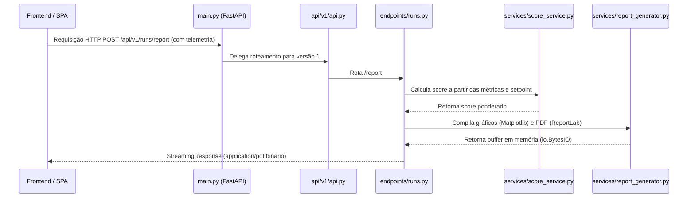

# Arquitetura e Fluxo da API (Modo Stateless)

Este documento detalha o funcionamento e a organização da API construída com FastAPI no diretório `backend/app`. A aplicação opera de maneira **stateless (sem banco de dados)**, focando em processamento de sinais, avaliação de métricas de controle e geração de laudos técnicos em PDF e exportação de telemetria em CSV.

## Fluxo Geral de uma Requisição

Quando uma requisição chega do frontend para o backend para geração de relatório, ela segue este caminho:

1. O servidor é inicializado através do arquivo principal (`main.py`).
2. A requisição passa pelos middlewares (como o CORS).
3. O roteador central (`api/v1/api.py`) direciona para os endpoints em `endpoints/runs.py`.
4. Os serviços de domínio realizam os cálculos numéricos e a geração de gráficos/PDF em memória.
5. A resposta binária é transmitida diretamente para o cliente, sem necessidade de escrita em disco ou banco.

---

## Responsabilidade dos Diretórios e Arquivos Principais

- **[`main.py`](file:///Users/klebervasconcelos/Documents/TCC/sketch-1/backend/app/main.py)**
  É a raiz da sua aplicação FastAPI. Configura CORS, documentação OpenAPI/Swagger e registra o roteador da v1.

- **`core/`**
  Configurações globais e metadados (`config.py`).

- **`schemas/`**
  Esquemas Pydantic (`run.py`) para validação estrita dos dados de telemetria e métricas de controle recebidas pelo cliente.

- **`services/`** *(Regras de Negócio e Processamento)*
  - `score_service.py`: Motor de pontuação com critérios de tempo de subida, acomodação, overshoot e erro final.
  - `report_generator.py`: Geração em memória do laudo técnico A4 em PDF com diagramas de controle e decomposição das ações P, I e D.
